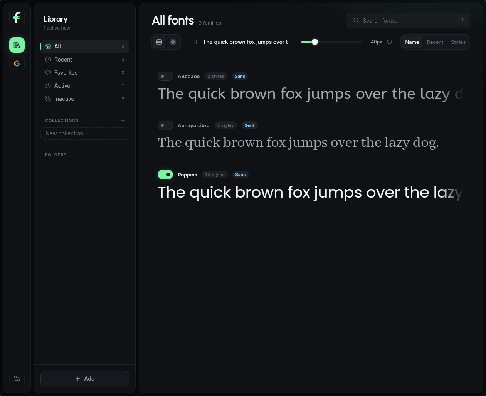

<div align="center">


# Fontin

**Gerenciador de fontes open source.**<br>
A fonte entra no sistema sem ser instalada: liga e desliga.

[](https://github.com/Kievy/fontin/releases/latest)
[](https://github.com/Kievy/fontin/releases)
[](LICENSE)


[**Baixar**](#-download) · [Recursos](#-recursos) · [Como funciona](#-como-funciona) · [Desenvolvimento](#-desenvolvimento)

<br>



</div>

<br>

## ✦ Recursos

|  |  |
| --- | --- |
| **Ativar sem instalar** | Um interruptor por família ou por estilo. Nada é copiado para as pastas do sistema — o Fontin só registra uma referência ao arquivo original. |
| **Google Fonts integrado** | O catálogo completo (~2.000 famílias) com prévia ao vivo, sem baixar nada. Ao ativar, os arquivos vão para o cache do app e ficam disponíveis em qualquer programa. |
| **Biblioteca organizada** | Pastas (com a árvore de subpastas), fontes avulsas, coleções com arrastar e soltar, favoritas, recentes, ativas e inativas. |
| **Sem duplicatas por engano** | Arquivos idênticos são reconhecidos pelo conteúdo; o Fontin avisa e você decide se adiciona mesmo assim. |
| **Rápido** | Núcleo em Rust: varredura paralela, índice em memória, lista virtualizada e rescans incrementais (só arquivos alterados são relidos). |
| **Do seu jeito** | Tema claro, escuro ou do sistema · português, inglês e espanhol · ícone na bandeja · iniciar com o sistema · desativar tudo ao sair. |
| **Sempre atualizado** | O app verifica novas versões no GitHub e se atualiza com um clique. |

### Atalhos

| Atalho | Ação |
| --- | --- |
| <kbd>/</kbd> ou <kbd>Ctrl</kbd> <kbd>K</kbd> | Buscar |
| <kbd>Ctrl</kbd> <kbd>1</kbd> | Biblioteca |
| <kbd>Ctrl</kbd> <kbd>2</kbd> | Google Fonts |
| <kbd>Ctrl</kbd> <kbd>,</kbd> | Configurações |
| <kbd>Esc</kbd> | Fechar o painel de detalhes |

No macOS, use <kbd>⌘</kbd> no lugar de <kbd>Ctrl</kbd>.

## ⬇ Download

Baixe a versão mais recente em **[Releases](https://github.com/Kievy/fontin/releases/latest)**:

| Sistema | Arquivo | Observação |
| --- | --- | --- |
| **Windows** 10/11 | `Fontin_<versão>_x64-setup.exe` | Instala em *Arquivos de Programas* (dá para escolher a pasta). |
| **macOS** Intel e Apple Silicon | `Fontin_<versão>_universal.dmg` | |
| **Linux** (qualquer distro) | `Fontin_<versão>_amd64.AppImage` | `chmod +x` e execute. Se atualiza sozinho. |
| **Linux** Debian · Ubuntu · Mint | `Fontin_<versão>_amd64.deb` | Bem menor: usa o WebKitGTK do sistema. Atualize baixando o novo `.deb`. |

> [!NOTE]
> Os instaladores ainda não têm assinatura de código da Microsoft/Apple.
> **Windows:** no aviso do SmartScreen, clique em *Mais informações → Executar assim mesmo*.
> **macOS:** se aparecer "o app está danificado", rode `xattr -cr /Applications/Fontin.app`.

## ⚙ Como funciona

Ativar uma fonte cria só uma referência ao arquivo original; desativar remove a referência. Seus arquivos nunca são movidos nem copiados.

| Sistema | Mecanismo | Duração |
| --- | --- | --- |
| Linux | Links em `~/.local/share/app.fontin.desktop/active`, registrados no fontconfig por `~/.config/fontconfig/conf.d/90-fontin.conf` | Permanente (até desativar) |
| Windows | `AddFontResourceW` + `WM_FONTCHANGE` | Sessão — reaplicado ao abrir o Fontin |
| macOS | `CTFontManagerRegisterFontsForURL` (escopo de sessão) | Sessão — reaplicado ao abrir o Fontin |

O que está ativo fica salvo na biblioteca (SQLite); ao iniciar, o Fontin reconcilia o sistema com ela. Para manter as fontes ativas no Windows/macOS após reiniciar o computador, ligue **Configurações → Iniciar ao ligar o sistema**.

## 🛠 Desenvolvimento

**Stack:** Rust + [Tauri 2](https://tauri.app) no núcleo · Svelte 5 + TypeScript na interface · SQLite para a biblioteca.

Pré-requisitos: Rust estável, Node 20+ e as [dependências do Tauri](https://tauri.app/start/prerequisites/) para o seu sistema.

```sh
npm install
npm run tauri dev     # app em modo desenvolvimento
npm run tauri build   # pacote de release
npm run check         # checagem de tipos do frontend

cd src-tauri
cargo test                # testes (inclui varredura de /usr/share/fonts)
cargo test -- --ignored   # testes com rede (catálogo e download do Google)
```

<details>
<summary><b>Estrutura do projeto</b></summary>

```
src-tauri/src/
  lib.rs            setup do Tauri e tarefas em segundo plano ao iniciar
  state.rs          AppState: biblioteca, banco, catálogo, ativador
  commands.rs       comandos IPC e eventos para a interface
  model.rs          tipos do domínio e tipos enviados à interface
  scanner.rs        varredura paralela e incremental (rayon + memmap2 + ttf-parser)
  library.rs        índice em memória: famílias, filtros, árvore de pastas
  db.rs             persistência SQLite
  google.rs         catálogo e download do Google Fonts
  activation/       ativação por sistema (linux, windows, macos)
  tray.rs           ícone e menu da bandeja
  i18n.rs           textos do backend (erros, bandeja) em pt-BR, en, es

src/lib/
  api.ts            chamadas tipadas ao backend
  store.svelte.ts   estado global e eventos do backend
  fonts.ts          carregamento sob demanda das prévias (LRU)
  i18n/             dicionários pt-BR, en, es
  styles/app.css    tokens de design (grade de 8 px, temas claro/escuro)
  components/       Rail, Sidebar, Header, FontList (virtualizada), DetailPanel…
```

</details>

<details>
<summary><b>Publicar uma versão</b></summary>

1. Atualize `version` em `package.json`, `src-tauri/tauri.conf.json` e `src-tauri/Cargo.toml`.
2. `git commit -am "Release v0.2.0" && git tag v0.2.0 && git push --follow-tags`

O workflow [`release.yml`](.github/workflows/release.yml) compila Linux (AppImage e `.deb`), Windows e macOS e publica a Release com o `latest.json` usado pelo atualizador. Um `git push` sem tag não gera versão. Requer o segredo `TAURI_SIGNING_PRIVATE_KEY` no repositório.

A configuração da janela é repetida em `src-tauri/tauri.windows.conf.json` e `src-tauri/tauri.macos.conf.json` (barra de título própria); mantenha as três em sincronia.

</details>

## Licença

[MIT](LICENSE) © Kievy
